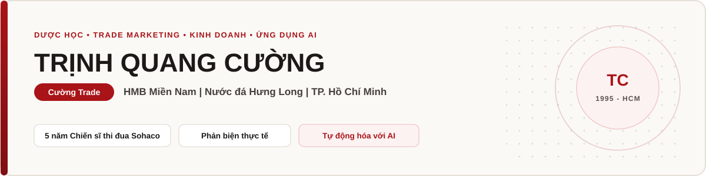

  <picture>
    <source media="(prefers-color-scheme: dark)" srcset="./assets/banner-dark.svg">
    <source media="(prefers-color-scheme: light)" srcset="./assets/banner-light.svg">
    
  </picture>

  

    
    &nbsp;
    
    &nbsp;
    
  

## Giới Thiệu Ngắn Gọn

- Chuyên ngành **Dược học**, hiện sinh sống và làm việc tại **Thành phố Hồ Chí Minh**.
- **5 năm làm việc tại Công ty Dược phẩm Sohaco**: cả 5 năm đều đạt danh hiệu **Chiến sĩ thi đua** và **Nhân viên xuất sắc**.
- Hiện phụ trách **Trade Marketing tại Công ty TNHH HMB Miền Nam** và vận hành **Cơ sở nước đá tinh khiết Hưng Long** tại Chơn Thành, Bình Phước.
- Thế mạnh cá nhân: học hiểu nhanh, nắm bản chất vấn đề và ứng dụng công cụ AI vào công việc thực tế.

## Bốn Mảng Đang Tập Trung

<table>
  <tr>
    <td width="50%" valign="top">
      <strong>Quản lý và Trade Marketing</strong> 
      Lập kế hoạch bán hàng theo số liệu, thiết kế chương trình điểm bán, đào tạo sản phẩm, rèn kỹ năng giao tiếp, xử lý từ chối và quản lý đội nhóm.
    </td>
    <td width="50%" valign="top">
      <strong>Kinh doanh và Đầu tư</strong> 
      Quản trị chi phí, giá vốn, điểm hòa vốn tại cơ sở nước đá tinh khiết Hưng Long và mở rộng đầu tư kinh doanh dựa trên dòng tiền thực tế.
    </td>
  </tr>
  <tr>
    <td width="50%" valign="top">
      <strong>Học tập và Ứng dụng AI</strong> 
      Tự động hóa xử lý bảng tính, báo cáo, bài trình chiếu và xây dựng hệ thống tài liệu cá nhân phục vụ học nhanh, làm việc có hệ thống.
    </td>
    <td width="50%" valign="top">
      <strong>Thương hiệu cá nhân</strong> 
      Chia sẻ góc nhìn thực tế từ công việc và quá trình tự học theo phong cách mộc mạc, gần gũi, dễ hiểu trên mạng xã hội.
    </td>
  </tr>
</table>

## Dự Án Đã Thực Hiện

<table>
  <tr>
    <td width="100%" valign="top">
      <strong><a href="https://thiduamomoi.ai.studio/momoid2/">Thi đua HMB Miền Nam</a></strong> 
      Ứng dụng web theo dõi và tổng hợp chương trình thi đua mở mới điểm bán Đợt 2 cho đội ngũ kinh doanh HMB Miền Nam.  
      
    </td>
  </tr>
</table>

## Công Cụ Làm Việc Hằng Ngày

  
  
  
  
  
  
  
  

## Nguyên Tắc Làm Việc

- **Với số liệu và báo cáo:** Đi thẳng vào con số thực tế, chỉ rõ nguyên nhân và đề xuất hướng xử lý.
- **Với đối tác:** Thực tế, tôn trọng và nêu rõ quyền lợi cùng điều kiện của từng bên.
- **Với công cụ AI:** Ưu tiên phản biện thẳng, chỉ ra lỗ hổng trước khi làm, nói tiếng Việt giản dị và không xu nịnh.

---

  Kết nối trực tiếp qua <a href="https://www.facebook.com/cuongtq95/">Facebook</a> hoặc Zalo <strong>0901 191 295</strong>.

